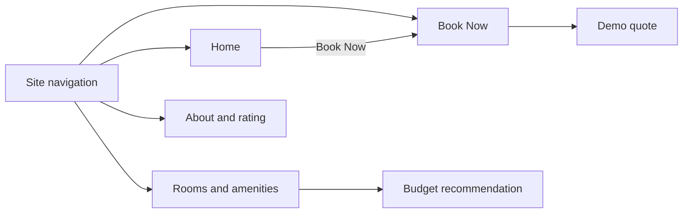

# The Wellhall Hotel

The Wellhall Hotel is a Web 1 course project that demonstrates a hotel website using HTML, CSS, and vanilla JavaScript. Visitors can browse rooms and amenities, find a room category within their budget, and calculate a sample booking quote.

## Run locally

Clone the repository and open [`public/index.html`](public/index.html) in your browser. The site runs without a build step or package installation.

```sh
git clone https://github.com/Abood03/web1-project.git
cd web1-project
```

To preview over HTTP, run this command from the repository root with Python 3 installed, then open `http://localhost:8000`.

```sh
python -m http.server 8000 --directory public
```

## Site map

Every page shares navigation to Home, Rooms, Book Now, and About. The home page also has a shortcut to the booking form.



## What you can try

| Page | Demo |
| --- | --- |
| Home | Open the booking form from the landing page. |
| Rooms | Browse Standard, Deluxe, and Suite rooms, view amenity details, and get a room recommendation by nightly budget. |
| Book Now | Enter sample guest details, select dates, a room, and extras, then review the live quote. |
| About | Read the hotel profile and try the star rating. |

Booking quotes and ratings run entirely in the browser. Use sample details when exploring the form.

## Documentation

- [Project guide and file map](docs/project-guide.md) covers the code structure, price calculation, and browser checks.
- [Publishing guide](docs/publishing.md) covers visibility, asset credits, and optional website hosting.
