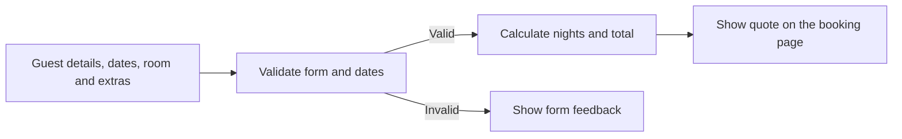

# Project guide

The site is a collection of four HTML pages. Each page loads the shared stylesheet and its own stylesheet. JavaScript handles the interactions on the Rooms, Book Now, and About pages.

## File map

```text
web1-project/
├── .gitignore                 Local editor and operating system files
├── README.md
├── docs/
│   ├── project-guide.md
│   └── publishing.md
└── public/
    ├── index.html             Home page and booking shortcut
    ├── rooms.html             Room categories, photos, and amenities
    ├── book-now.html          Guest details and sample booking quote
    ├── about.html             Hotel profile and star rating
    └── assets/
        ├── css/
        │   ├── site.css       Shared styles and navigation
        │   ├── home.css       Home page styling
        │   ├── rooms.css      Rooms and amenities styling
        │   ├── booking.css    Booking form and quote styling
        │   └── about.css      About sections and rating styling
        ├── js/
        │   ├── rooms.js       Room details and budget recommendations
        │   ├── booking.js     Form validation and quote calculation
        │   └── about.js       Star rating and acknowledgement
        └── images/            Hotel, room, and amenity imagery
```

Start with the corresponding HTML page when changing content. Use the page stylesheet for layout and appearance, and edit `site.css` for shared navigation styles. Use relative links with the exact letter case of each file so the pages work under a repository subpath and on case-sensitive hosts.

Room and amenity galleries use the corresponding subfolders within `public/assets/images/galleries/`. Earlier room photos are in `public/assets/images/legacy-rooms/`. The home and booking pages use `public/assets/images/screen_2x.jpg` for their background.

## Room budget and pricing

The Rooms page opens a budget prompt when it loads. Enter a nightly budget to get a category recommendation. The thresholds match the booking form's base rates. Click a room or amenity's details button to open its panel and double-click to close it.

| Room type | Base nightly rate | Budget recommendation |
| --- | ---: | --- |
| Standard | $100 | At least $100 and under $200 |
| Deluxe | $200 | At least $200 and under $300 |
| Suite | $300 | $300 and above |

Positive budgets below $100 return a below-minimum message. The recommendation uses the base room rate. Select extras separately on Book Now.

## Booking quote

The booking form uses the guest's name, email, and mobile number for the on-page summary. It calculates the number of nights from the check-in and check-out dates. The check-out date must be later than the check-in date.

| Optional extra | Nightly charge |
| --- | ---: |
| Gym | $10 |
| Spa | $50 |
| Breakfast | $15 |

**Total = (nightly room rate + selected nightly extras) × number of nights.** A two-night Deluxe stay with breakfast totals **$430**.

The quote appears as soon as the form is valid and updates when the inputs change. **Review quote** moves focus to the summary on the same page. Guest details stay in the current browser page for the demo. Use the result as a sample price estimate.



To change room rates, update the labels and numerical `roomType` values in `book-now.html`, the corresponding prices and budget thresholds in `rooms.js`, and the table above. For extras, update the labels and numerical `extras` values in `book-now.html` alongside the extras table. `booking.js` reads the selected input values to calculate the quote.

## About and rating

The cards on the About page link to sections for the hotel profile, history, vision, rating, and contact information. Selecting a star updates the displayed rating. Submitting shows a browser acknowledgement. Ratings stay on the page and are discarded when it reloads. The icon stylesheet loads from a CDN, so the icons require an internet connection.

## Verify a change

1. Open `public/index.html` and follow each navigation link. Confirm the pages, styles, and images load and that the home page shortcut opens Book Now.
2. On Rooms, try budgets `99`, `100`, `199.99`, `200`, and `300`. Confirm the thresholds in the pricing table and open a room or amenity detail panel.
3. On Book Now, fill the form with sample details. Pick a two-night Deluxe stay with breakfast and confirm the live quote is `$430.00`. Select **Review quote** and confirm focus moves to the summary. Try ending the stay on the check-in date and confirm the form rejects it.
4. On About, follow a section card, choose a star rating, and submit it. Confirm the acknowledgement and reload the page to check the rating resets.
